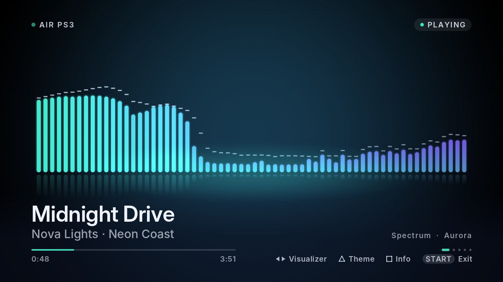
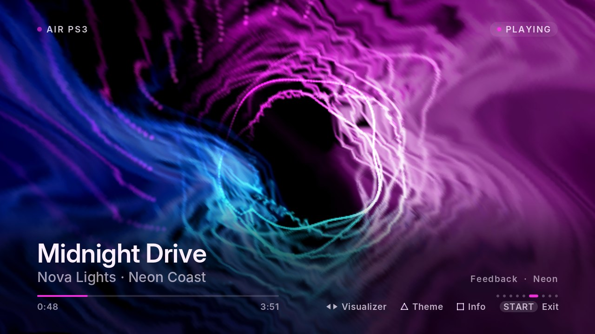
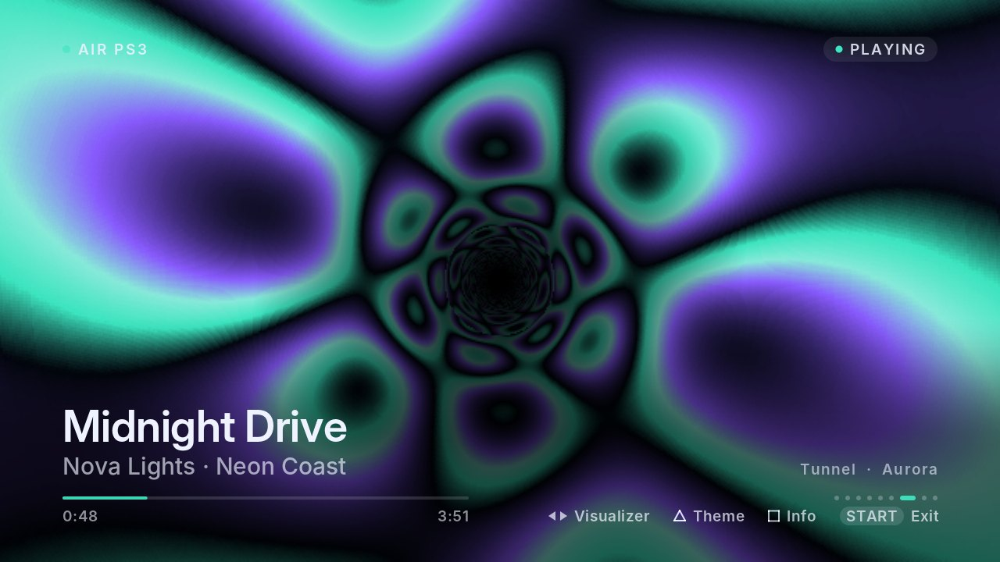
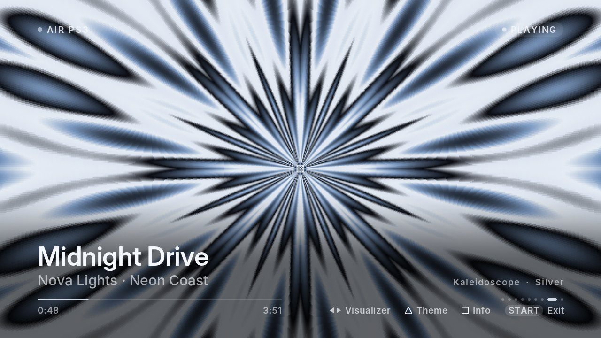
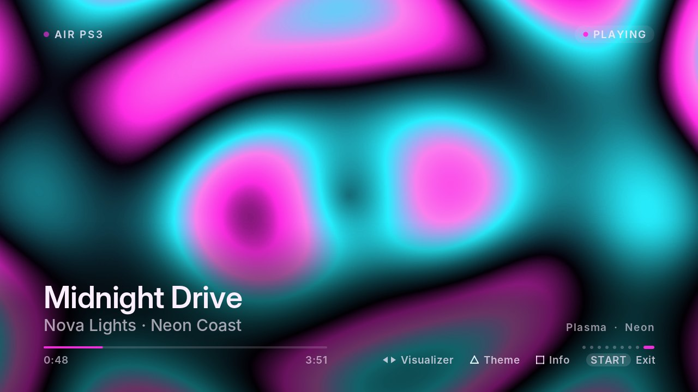
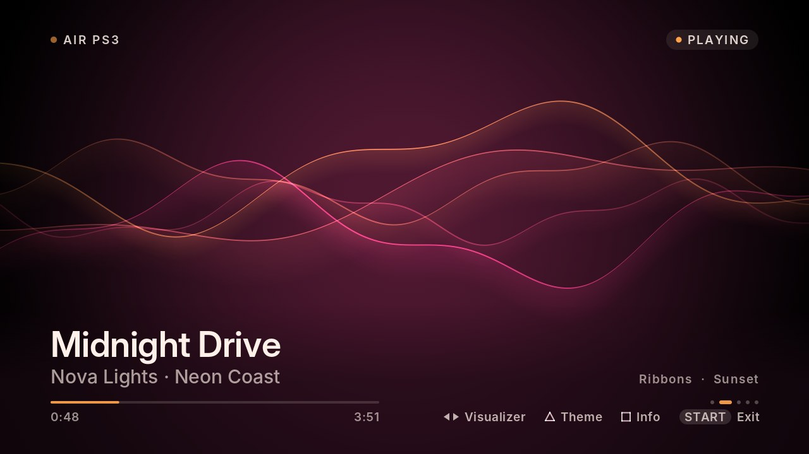
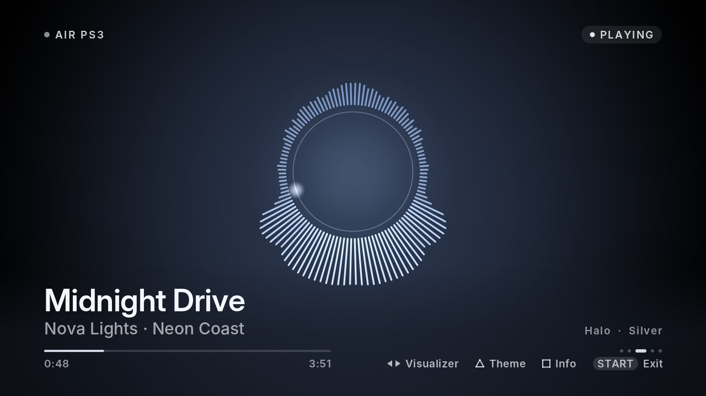

# AIR PS3 Visualizer



**Turn your PlayStation 3 into an AirPlay speaker with a music visualizer.**

Stream audio from your iPhone to a PS3 running custom firmware. Pick
**AirPS3** in the iPhone's AirPlay menu and the console plays the sound, shows
what's playing, and animates to the music.

AIR PS3 Visualizer builds on [AIR PS3](https://github.com/MKWorldWide/ps3-airplay)
by [EsKaye](https://github.com/EsKaye) (MIT licensed). The AirPlay 1 receiver
is the same; this edition adds the animated interface. It installs as its
own app (`AIRPLAY03`), so it can sit next to the original AIR PS3.

## Features

- **Now playing:** song title (wrapped onto extra lines so long names show in
  full), artist and album, a progress bar, and a status label (Ready /
  Connecting / Playing / Paused). Song info comes from the iPhone.
- **Nine visualizers**
  - Classic: Spectrum, Ribbons (XMB-style waves), Halo, Scope, Nebula
  - Trippy, full screen: Feedback (MilkDrop-style), Tunnel, Kaleidoscope,
    Plasma
- **Six color themes:** Aurora, Sunset, Silver, Ocean, Neon, Ember.
- **Overlays:** a volume bar when you change volume on the phone, and a label
  when you switch visualizer or theme.
- Your visualizer, theme and info-panel choices are remembered.

| | | |
| --- | --- | --- |
|  |  |  |
|  |  |  |

## Controls

| Button | Action |
| --- | --- |
| ◀ ▶ or L1 / R1 | Previous / next visualizer |
| △ (or ▲ / ▼) | Next / previous color theme |
| □ | Hide / show the song info |
| ✕ ○ SELECT | Show the control hints |
| START | Exit to the XMB |

## Download and install

1. Download the latest `air-ps3-visualizer-<version>.pkg` from the
   [Releases page](https://github.com/spookyjbp/air-ps3-visualizer/releases).
2. Copy it to a USB drive, then install it with the XMB **Package Manager**
   (Install Package Files → Standard).
3. Launch **AIR PS3 Visualizer** from the **Game** column.
4. On your iPhone, open the AirPlay audio menu (Control Center → AirPlay) and
   choose **AirPS3**.

Requirements: a PS3 with custom firmware that installs debug/homebrew PKGs.
The receiver was tested by the original project on Evilnat 4.93 CFW
(Cobra 8.5); other firmware hasn't been verified. Retail firmware isn't
supported.

To remove it, highlight the app in the XMB, press △ and choose **Delete**.
More details: [installation guide](docs/INSTALLATION.md).

## Good to know

- It's an AirPlay **1** audio receiver: your music app keeps running on the
  phone. It doesn't do AirPlay video, Spotify Connect, or background audio
  while you play games.
- The first time you pick one of the trippy modes, the screen pauses for a
  moment while it sets up.
- A diagnostic log is written to `/dev_hdd0/tmp/air-ps3-visualizer.log`.
  The `VISUAL_*` lines record frame timing, which helps with bug reports.
  It can contain network details, so check it before sharing it publicly.

## Build it yourself

See [Build from Source](docs/BUILD_FROM_SOURCE.md) for the PS3DK v0.27.0 /
PSL1GHT toolchain, and [Visual UI](docs/VISUAL_UI.md) for how the interface
works, how to preview it on a computer, and the tests.

```sh
scripts/run-host-tests.sh            # protocol, audio and UI tests (no PS3 SDK)
build/ui_preview video | ffmpeg ...   # preview the UI on a computer
```

## Credits and license

- Original AIR PS3 AirPlay receiver: [EsKaye](https://github.com/EsKaye) /
  [MKWorldWide](https://github.com/MKWorldWide/ps3-airplay).
- Visualizer edition: [spookyjbp](https://github.com/spookyjbp).
- Text uses the [Inter](https://github.com/rsms/inter) typeface (SIL OFL 1.1).

Project code is under the [MIT License](LICENSE). Third-party components have
their own notices; see [Third-party notices](THIRD_PARTY_NOTICES.md).
AirPlay and iPhone are trademarks of Apple Inc.; PlayStation is a trademark of
Sony Interactive Entertainment. This project isn't affiliated with or endorsed
by either.
