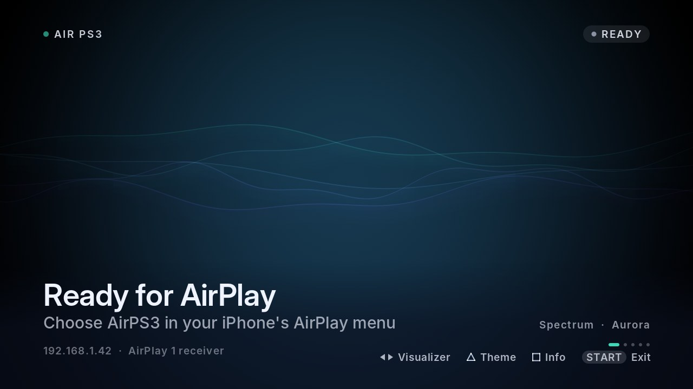
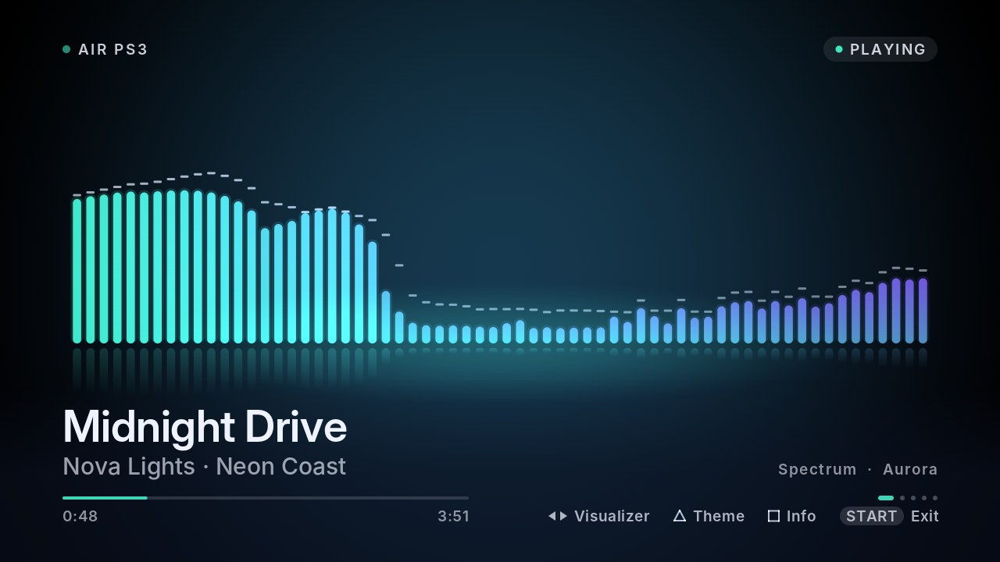
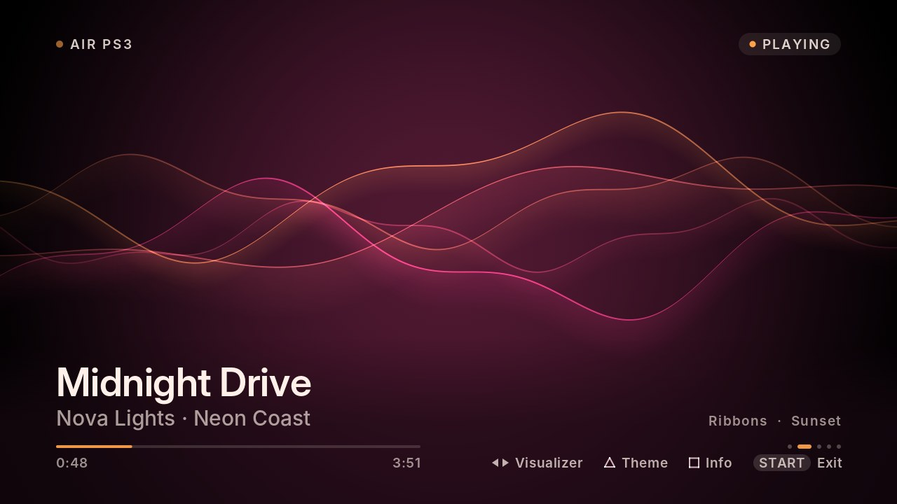
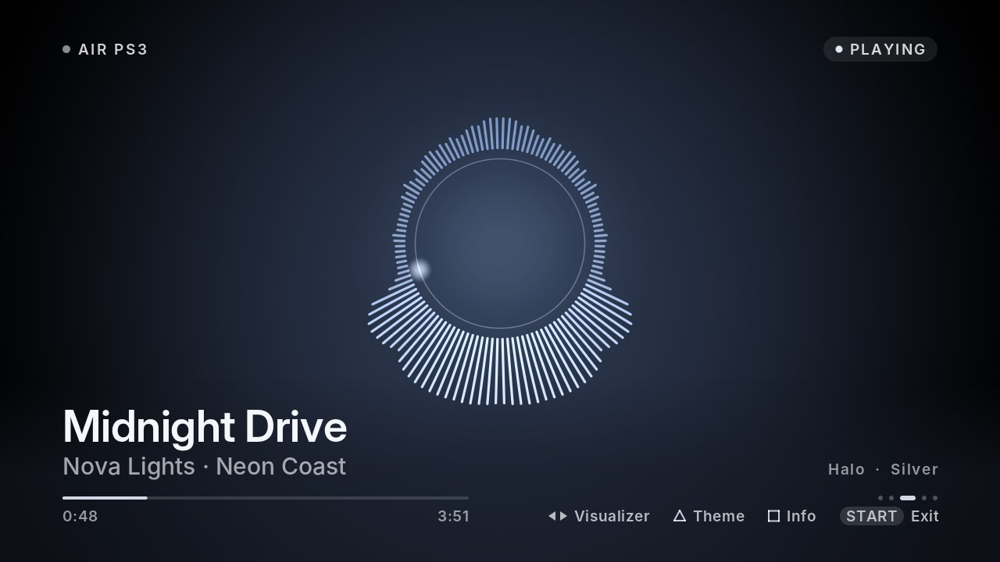
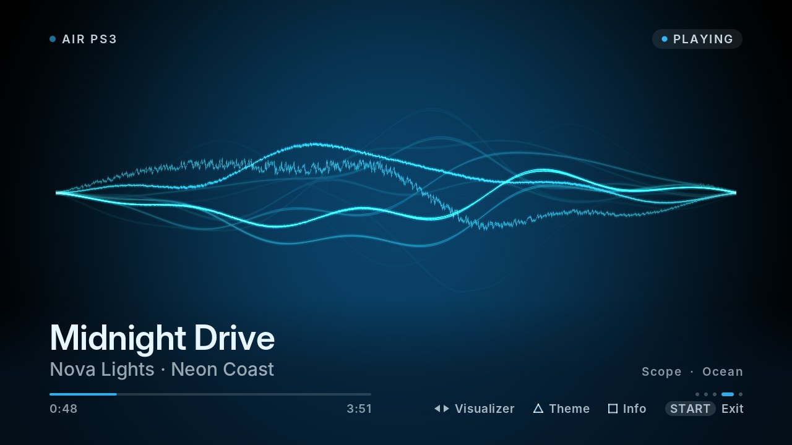
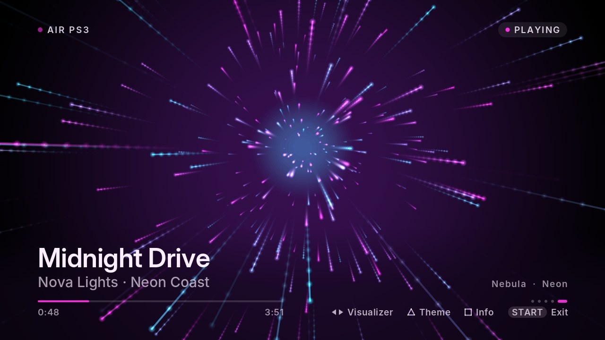

# Visual UI (Visualizer Edition)

This fork replaces AIR PS3's static background with an animated, music-reactive
interface: a clean now-playing screen, five visualizers, six color themes, and
volume/mode overlays. AirPlay discovery, decryption, ALAC decoding and audio
output are unchanged.



## What's on screen

| State | Shows |
| --- | --- |
| Waiting | "Ready for AirPlay", the name to pick on your iPhone, the console's IP address, and slow ambient ribbons |
| Connecting | Status pill changes as soon as the phone starts a session |
| Playing | Track title, artist · album, a progress bar with elapsed/total time, and the selected visualizer |
| Paused | Visuals dim, progress freezes, status pill shows PAUSED |

Track text and progress come from the sender. The receiver now advertises
`md=0,2` (text + progress, no artwork), so iOS sends title/artist/album with
`SET_PARAMETER`. Apps that don't publish metadata show "AirPlay audio".

## Controls

| Button | Action |
| --- | --- |
| ◀ ▶ (or L1 / R1) | Previous / next visualizer |
| △ (or ▲ / ▼) | Next / previous color theme |
| □ | Hide / show the info panel (visualizer-only view) |
| ✕ ○ SELECT | Show the control hints again |
| START | Exit to the XMB (unchanged) |

The hints fade out a few seconds after the last button press. Mode, theme and
info-panel choices are saved to
`/dev_hdd0/game/AIRPLAY02/USRDIR/ui-settings.txt` about three seconds after a
change, and on exit.

## Visualizers

| | |
| --- | --- |
| **Spectrum** — 64 log-spaced bars with peak caps and a floor reflection |  |
| **Ribbons** — XMB-style translucent waves; bass, mids and treble each drive a ribbon |  |
| **Halo** — mirrored radial spectrum, bass at the bottom, pulses on beats |  |
| **Scope** — triggered stereo waveform with phosphor trails |  |
| **Nebula** — a starfield that surges with the kick drum |  |

Themes: Aurora, Sunset, Silver, Ocean, Neon, Ember.

## How it works

```
audio thread (main)                         render thread (air-ps3-visual)
───────────────────                         ──────────────────────────────
ALAC → PCM ring → GameOS block ─┬─ gain → audio port
                                └─ ui_audio_tap (lock-free copy) ──► snapshot (~21 ms delay)
RTSP session / metadata ── seqlock status ─────────────────────────► ui_app_render
controller edges ── 16-slot command queue ─────────────────────────►   FFT → bands/beat
sysutil menu events ── flag ───────────────────────────────────────►   visualizer + HUD
                                                                     copy → RSX buffer → flip
```

- `src/ui/` is portable C with no PS3 dependencies: XRGB canvas primitives
  (anti-aliased shapes, additive glow, alpha text), a 1024-point FFT with
  64 log bands, beat detection and smoothing, the visualizers, themes, and the
  HUD/state machine. It is unit-tested on the host and drives the preview tool.
- `prototype/standalone-receiver/source/visual_renderer.c` runs the UI on a
  lower-priority PPU thread. It borrows the double-buffered scanout that
  `diagnostic_screen` already sets up, so the original artwork shows while it
  starts. It never draws into a buffer until the previous flip has completed.
- While the PS-button menu is open, it stops drawing but keeps pacing flips of
  the last two finished frames (same approach as the original presenter).
- The render thread never writes the log (the log queue is single-producer).
  The main thread logs `VISUAL_FRAMES`, `VISUAL_RENDER_US_MAX` and
  `VISUAL_COPY_US_MAX` with each heartbeat.
- If the renderer stops (for example a flip that never completes), the main
  thread logs `VISUAL_STOPPED` and returns to the original static screen.
- The audio tap is taken before AirPlay volume is applied, so visuals look the
  same at any volume.

Canvas memory: four 1280×720 XRGB buffers (~14.7 MB). The UI renders at
1280×720 and is scaled to the console's output mode (1080p, 720p or SD).

## Performance and tuning

On a desktop CPU a full frame takes about 2.5–5 ms depending on the mode
(`build/preview/ui_preview bench`). The PS3's PPU is considerably slower
per clock, and this has not been measured on hardware yet. Rendering runs on
its own thread below the audio thread's priority, so a slow frame lowers the
frame rate rather than interrupting audio.

Build knobs (pass to `make` in `prototype/standalone-receiver`):

- `VISUAL_TARGET_FPS=30` caps the frame rate (default 60).
- `VISUAL_AUDIO_DELAY_FRAMES` (compile-time define in `visual_renderer.h`)
  shifts visuals relative to sound if your TV adds latency.

## Preview on a computer

```sh
gcc -O2 -std=c11 -Isrc/ui tools/ui-preview/ui_preview.c src/ui/*.c -lm -o build/ui_preview
build/ui_preview bench
build/ui_preview still 2 3 2 halo.ppm      # mode theme state output
build/ui_preview video | ffmpeg -f rawvideo -pix_fmt rgb24 -s 1280x720 -r 30 -i - preview.mp4
```

The preview uses the same `src/ui` code as the console build, driven by a
synthetic song.

## Tests

`scripts/run-host-tests.sh` (needs Mbed TLS headers and a host
`libmbedcrypto.a`) runs every protocol/audio test plus:

- `tests/protocol/raop_metadata_test.c` — DMAP parsing, UTF-8 sanitizing,
  truncation, nesting limits, progress parsing, and session integration
  (malformed metadata and unsolicited artwork are acknowledged and ignored).
- `tests/ui/ui_test.c` — pixel math, text fitting, FFT band placement, audio
  tap ordering, settings parsing, and rendering every mode/theme/state under
  ASan/UBSan.
- `tests/observability/visual_renderer_test.c` — the real render thread
  against mocked RSX/flip/thread APIs at 720p, 1080p and 480p: paced frames,
  menu pause, command handling, settings persistence, and flip-timeout
  fallback.

## Not yet verified

- Frame rate and audio stability on a real PS3 (the release gate in
  [TEST_MATRIX](TEST_MATRIX.md) still applies).
- Metadata from senders other than the iOS Music app.
- Album artwork (not advertised; would need a JPEG decoder and a larger RTSP
  body limit).
